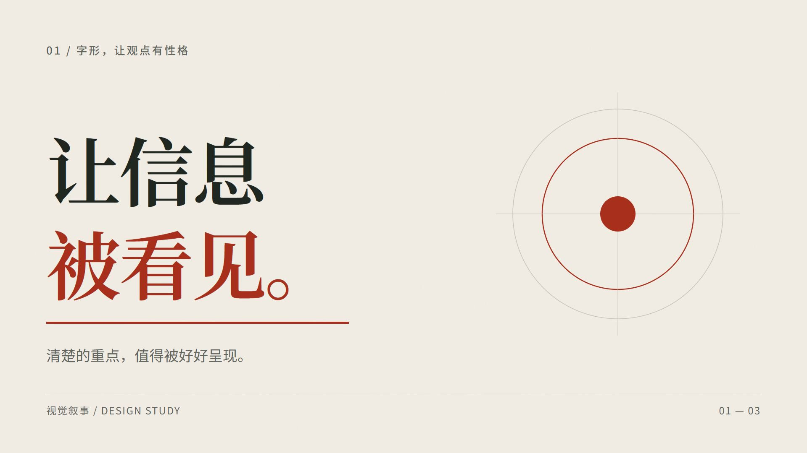
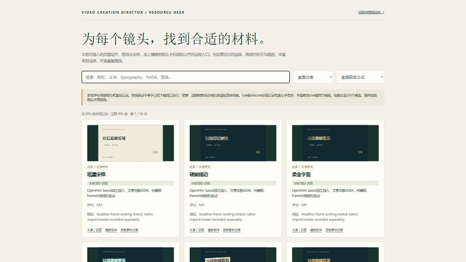

# Video Creation Director · 视频创作总导演

一个视频入口，统筹需求、真实素材、参考镜头、视觉设计、制作和验收。支持中文视频任务，按需调用 MotionGit、Motion、Remotion 与剪辑工具。用户可以只给一句话，内部仍完成必要制作工作。

**[浏览素材库](https://yangwei251003.github.io/video-creation-director/resources.html) · [观看原创横竖屏示例](https://yangwei251003.github.io/video-creation-director/) · [技能正文](skill/SKILL.md) · [升级说明](UPGRADE.md)**



## 2.1 新增

- OpenFilm本地桌面工作台：统一对话修改、手动编辑、版本及内部渲染能力；保留用户改动。
- 人与Agent共用的895条素材索引：覆盖视频/图片、音频、贴纸、字体、花字、文字动画、特效、滤镜、转场与模板，保留阿杜/Vincent的精确来源、版本、获取方法和许可。
- 27个原创可编辑OpenFilm页面；本机另准备100个Kenney音效、30个Lucide图标、6款字体及2个NASA源视频。第三方原素材不随公共仓库捆绑。
- 后台操作优先：项目读写、原生版本、资源导入、Codex适配器与无头验证，避免占用用户屏幕鼠标。
- 按实际镜头禁重，裁切/镜像/变速不能绕过；每个素材镜头至少3候选、1主选及可用备选。
- 判重对照真实时间线、源片段、媒体散列与多帧相似候选；缺证据不放行。
- 声音事件、实测起音参考、浮点分轨、混音、公开CC0获取；没有听审不宣称音质达标。
- [三条新教程研究](research/tutorials/sound-openfilm.md) · [OpenFilm验证工程构建说明](examples/openfilm-lab/README.md)。



895是分层记录数，含来源库、镜头卡、父子变体、单个素材和方法；不是895套独立视频模板，也不表示全部远程内容已运行。本机27页原生导入、27页确定性检查及代表页真实渲染已验证。30秒有声工程完成渲染、解码、背景Agent局部修改和原生编辑闭环；完整连续看审、听审和优秀总分仍未验证。[2.1验证范围](validation/director21/README.md)

## 在工作台使用素材

先在[素材目录](https://yangwei251003.github.io/video-creation-director/resources.html)查找方向，或让Agent执行：

```sh
python skill/scripts/resource_catalog.py --category text-animation --limit 5
python skill/scripts/resource_catalog.py 阿杜 --limit 3
python skill/scripts/resource_catalog.py --id icon:camera
```

原生页面源包在 `resources/starter-pack/`。复制到独立资源根的 `Starter/` 后，可用 `resources/install_native.py --resources <root> --saved <OpenFilm-Saved-root> --apply` 比较并备份安装。已配置机器从OpenFilm「素材 → Saved → Director 2.1」使用；字体要在具体页面中用本地 `@font-face` 引用，放入Saved不等于系统安装。远程记录给出源码/下载/API入口；滤镜示例和GLSL转场需按实际媒体适配。[接入、许可与后台操作](skill/references/resource-library.md)

## 2.0 基础能力

- 字体按标题、正文、数字分工：中文替换方向、字重轴、字形覆盖、8种文字动效配方。
- 6组美术方向、7类转场方法、24种信息组件选型；从内容关系决定形式。
- 主动联网核实内容并下载必要的图片、视频、音乐、字体、组件、官方案例；登记来源并实际接入镜头。
- 阿杜28项 MotionGit 页面与演示抽帧研究；Vincent全部58个公开仓库逐项清点，核心视频资源554条分类索引。索引条目不是554套独立模板。
- 3条指定抖音教程的真实媒体取得、全音轨本地自动转写与关键画面核验；新增可复用的公开抖音解析工具。
- 先测代表性片段，再扩展与返修；用户要求直接制作时，不强加确认关卡。
- 按证据验收。技术解码、静帧、连续看审和听审分开；证据不全不给完整质量总分。

## 安装到 Codex

需要Python 3.12或更新版本。克隆仓库后运行：

```sh
python install.py
python install.py --apply
```

第一条只比较文件；第二条把 `skill/` 安装为用户目录下的 `.codex/skills/video-creation-director`。同名旧技能先整份备份，再校验并替换；备份路径会输出，已有 `local-environment.json` 会保留。其他技能、MCP配置和全局指令不会被安装脚本改动。可用 `--codex-dir <directory>` 指定测试安装根。

安装后建议开启新对话刷新技能列表。现有对话也可以明确读取新 `SKILL.md`。Motion、MotionGit、Remotion等保留为内部依赖，按实际任务准备；本仓库不捆绑账户绑定的模板或任何密钥。

用户可在自己的指令中加入：

> 制作、改编或剪辑视频时先使用 video-creation-director。沿用已有要求；必要时主动查找并下载相关内容和素材，核对来源后接入镜头。按具体参考和评分标准验收；要求直接制作时不增设不必要的确认。

## 使用示例

```text
帮我做一支15秒的竖屏产品发布视频，直接制作。突出新功能的真实使用过程，配色沿用官网，保留可编辑工程。
```

```text
把这段采访剪成60秒，保留意思和关键数字。必要时寻找可用的官方案例和解释素材，不要只做字幕大字报。
```

```text
解析这个抖音教程，核对屏幕里的参数和操作步骤，把可复用的方法应用到本片。
```

只有会实质改变结果的缺项才需要澄清。可逆风格选择由导演判断，已有信息不重复问。

## 视频解析环境

获取公开视频只需Python标准库。转写和OCR使用独立环境：

```sh
python -m venv .video-reader-venv
# 用这个环境的 python 运行下一条（Windows 位于 Scripts，macOS/Linux 位于 bin）
python -m pip install -r skill/scripts/requirements-video-reader.txt
python skill/scripts/read_douyin.py "<抖音分享链接>" --out private-evidence --transcribe --model small --frames 16 --ocr
```

需要将上述 `python` 切换成新环境内的解释器。首次 `small` 会下载免费模型，也可传已有模型目录。只取得精确编号对应的公开视频；不读取用户Cookie或密钥。接口会变化，已删除/受限内容不能保证读取。原视频、完整转录、截图是私人研究材料，不自动公开。

当前兼容组合固定 faster-whisper 1.2.1 与 PyAV 16.1.0，避免 PyAV 19 已知API冲突。[上游问题](https://github.com/SYSTRAN/faster-whisper/issues/1589)

## 可运行示例与检查工具

`examples/design-lab/` 是原创15秒横竖屏 Remotion 工程，展示中文宋黑搭配、语义分组、结构示意、共享视觉锚点与连贯转场。它是设计验证场，不是任意题材的成片模板。[运行说明](examples/design-lab/README.md)

```sh
python skill/scripts/search_references.py "纸面" --library adu --limit 3
python skill/scripts/preflight.py
python skill/scripts/qa_video.py output.mp4 --out inspection --width 1080 --height 1920 --fps 30
python skill/scripts/check_review.py review.json
```

FFmpeg不在当前PATH时传 `--ffmpeg-dir`。检查器只核验技术与记录；`PASS_RECORD_ONLY` 不代表审美优秀。演示本身已实际渲染和解码、检查静帧，未据此声称完整连续声画评审通过。

## 研究和许可

- [阿杜逐模板研究](research/adu/report.md)：28项；原生模板规则、输入合同和版本差异。
- [Vincent逐仓库研究](research/vincent/report.md)：58仓库；核心库镜头卡、变体、历史demo分别计数。
- [Vincent教程](research/tutorials/vincent.md)、[另外两条教程](research/tutorials/report.md)：时间码与方法适配。
- [视频读取工具选型](research/video-acquisition-tools.md)、[验证说明](validation/summary.md)。

MIT许可只覆盖本项目原创内容与代码。第三方模板、字体、音乐、源码分别保留原许可；NC资源只做方法研究与链接索引，未捆绑其完整技能/实现。详见 [THIRD-PARTY-NOTICES.md](THIRD-PARTY-NOTICES.md)。下载器开源不代表第三方视频可以再发布。

本项目承诺具体标准与可核查的制作过程，不承诺任意输入一次生成必然达到大师水准。
